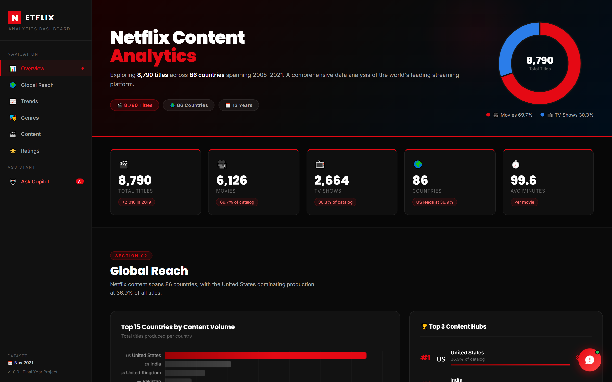
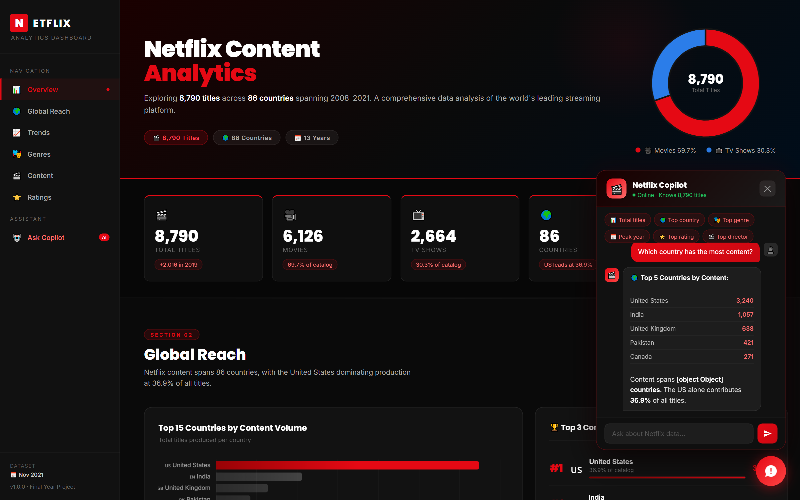

# 🎬 Netflix Content Analytics — Final Year Project

<div align="center">


<br/><br/>

**A comprehensive data analysis and visualization project exploring Netflix's content library across 8,790 titles, 86 countries, and 13 years of growth.**

<br/>

[🌐 Live Dashboard](https://YOUR_USERNAME.github.io/netflix-analytics/) &nbsp;·&nbsp; [📊 Power BI Report](./powerbi/README.md) &nbsp;·&nbsp; [📖 Project Report](./docs/project_report.md) &nbsp;·&nbsp; [🔍 Insights](./analysis/insights.md)

</div>

---

## 📸 Dashboard Preview

<div align="center">

### Executive Overview & Live Metrics


<br/>

### 🤖 Built-in AI Data Copilot in Action
<p align="center">
  
</p>

> 💡 **Embedded AI Copilot:** Instant answers to natural-language questions about content, countries, genres, and directors grounded strictly on the 8,790 Netflix catalog records.

</div>

<p align="center">
  <a href="screenshots/README.md"><strong>👉 View the Full Screenshot & Chart Gallery (8 High-Res Captures)</strong></a>
</p>

---

## 🏗️ Project Structure

```
📁 netflix-analytics/
│
├── 📄 index.html                    ← 🎯 Interactive Web Dashboard + Embedded AI Copilot
├── 📄 README.md                     ← 📖 Project documentation (this file)
├── 📄 LICENSE                       ← ⚖️  MIT License
├── 📄 .gitignore                    ← 🚫 Git ignore rules
│
├── 📁 dataset/                      ← 📊 Data Files
│   ├── Cleaned_Netflix_Dataset.csv  ← ✅ Cleaned dataset (8,790 rows, 15 cols)
│   ├── Raw_Netflix_Dataset.csv      ← 📋 Original raw dataset
│   └── data_dictionary.md          ← 📖 Column descriptions & data types
│
├── 📁 powerbi/                      ← 📊 Power BI Report
│   ├── Netflix_Dashboard.pbix       ← 💼 Power BI Desktop file
│   └── README.md                   ← 📖 DAX measures & setup guide
│
├── 📁 analysis/                     ← 🐍 Python Analysis & Automation
│   ├── netflix_eda.py              ← 📈 Exploratory Data Analysis script
│   ├── capture_screenshots.py     ← 📸 Automated headless browser screenshot generator
│   └── insights.md                 ← 💡 Key findings & interpretations
│
├── 📁 screenshots/                  ← 📸 Dashboard Screenshots
│   ├── dashboard-overview.png      ← 🖼️ Main dashboard view
│   ├── copilot-preview.png         ← 🤖 AI Copilot dialog interaction
│   ├── full-dashboard.png          ← 📜 Complete full-page dashboard capture
│   ├── kpi-cards.png               ← 🔢 High-level metric counters
│   ├── README.md                   ← 📖 Visual gallery & regeneration guide
│   └── charts/                     ← 📁 Individual chart captures
│       ├── top-countries.png
│       ├── content-growth.png
│       ├── genres-chart.png
│       └── ratings-directors.png
│
└── 📁 docs/                         ← 📄 Project Documentation
    └── project_report.md           ← 📝 Full academic project report
```

---

## 🌟 Features

### 🌐 Interactive Web Dashboard (`index.html`)
| Feature | Detail |
|---------|--------|
| 🤖 **AI Data Copilot** | Built-in smart assistant answering questions directly from the 8,790 dataset titles |
| 🎨 **Design System** | Netflix cinematic dark theme (`#0a0a0a`), glassmorphism cards, responsive sidebar |
| 📊 **Visual Analytics** | 8 interactive Chart.js visualizations with custom dark-mode tooltips |
| 🔢 **Executive KPIs** | 5 animated metric counters (Total, Movies, TV Shows, Countries, Avg Runtime) |
| 📱 **Responsive UI** | Fluid layout adapting gracefully from 4K displays down to mobile screens |
| ⚡ **Zero Setup** | Self-contained single-file frontend — open in any modern browser without servers |
| 🧭 **Smooth Navigation** | Sidebar nav with real-time `IntersectionObserver` active section tracking |

### 📊 Power BI Report (5 Pages)
| Page | Content |
|------|---------|
| Overview | KPIs, content split, year-over-year growth |
| Geographic | World map, top countries, regional breakdown |
| Genres | Treemap, genre co-occurrence, filters |
| Ratings & Duration | Ratings distribution, duration histograms |
| Trends | Monthly heatmap, director rankings, content age |

### 🐍 Python EDA (`analysis/netflix_eda.py`)
- Full exploratory analysis with Pandas
- 8-panel matplotlib figure saved as PNG
- Genre frequency analysis using Counter
- Statistical summaries for duration, year, ratings

---

## 📈 Key Insights

<table>
<tr>
<td width="50%">

**📺 Content Mix**
- 🎬 Movies: **69.7%** (6,126 titles)
- 📺 TV Shows: **30.3%** (2,664 titles)
- Avg movie: **99.6 minutes**

**🌍 Top Countries**
- 🇺🇸 United States — 3,240 titles
- 🇮🇳 India — 1,057 titles
- 🇬🇧 United Kingdom — 638 titles

</td>
<td width="50%">

**📅 Growth Highlights**
- 🏆 Peak year: **2019** (2,016 titles)
- 📉 COVID dip: **2020** (1,879 titles)
- 40× growth from 2015 → 2019

**🎭 Top Genres**
- 🌐 International Movies — 2,752
- 🎭 Dramas — 2,426
- 😄 Comedies — 1,674

</td>
</tr>
</table>

---

## 🚀 Getting Started

### 1. View the Web Dashboard
```bash
# Simply open in your browser — no server needed
start index.html          # Windows
open index.html           # macOS
xdg-open index.html       # Linux
```

### 2. Run Python Analysis
```bash
# Install dependencies
pip install pandas matplotlib seaborn numpy

# Run analysis script
cd analysis
python netflix_eda.py
```

### 3. Open Power BI Report
1. Install [Power BI Desktop](https://powerbi.microsoft.com/desktop/) (free)
2. Open `powerbi/Netflix_Dashboard.pbix`
3. Refresh data source → point to `dataset/Cleaned_Netflix_Dataset.csv`

### 4. GitHub Pages Deployment
```bash
# Push to GitHub then enable Pages
git init
git add .
git commit -m "🎬 Netflix Analytics — Final Year Project"
git remote add origin https://github.com/YOUR_USERNAME/netflix-analytics.git
git push -u origin main
```
Then: **GitHub → Settings → Pages → Source: main / root** → Live in ~60 seconds!

---

## 🛠️ Tech Stack

| Category | Technology | Purpose |
|----------|-----------|---------|
| **Frontend** | HTML5 + CSS3 | Dashboard structure & styling |
| **Charts** | [Chart.js 4.x](https://chartjs.org) | Interactive visualizations |
| **Typography** | Google Fonts (Poppins + Inter) | Professional typography |
| **Analysis** | Python 3 + Pandas | Data cleaning & EDA |
| **Visualization** | Matplotlib + Seaborn | Static chart generation |
| **BI Tool** | Microsoft Power BI | Business intelligence report |
| **Version Control** | Git + GitHub | Code management & deployment |

---

## 📊 Dataset Details

| Attribute | Value |
|-----------|-------|
| **Source** | Netflix Public Dataset (Kaggle) |
| **Period** | 2008 – November 2021 |
| **Total Titles** | 8,790 (cleaned) |
| **Countries** | 86 unique countries |
| **Genres** | 42 unique categories |
| **Directors** | 4,000+ unique directors |
| **Features** | 15 columns |

> See [`dataset/data_dictionary.md`](./dataset/data_dictionary.md) for full column reference.

---

## 📄 Documentation

| Document | Location | Description |
|----------|----------|-------------|
| Project Report | [`docs/project_report.md`](./docs/project_report.md) | Full academic report with methodology |
| Key Insights | [`analysis/insights.md`](./analysis/insights.md) | Findings and interpretations |
| Data Dictionary | [`dataset/data_dictionary.md`](./dataset/data_dictionary.md) | Column reference & data types |
| Power BI Guide | [`powerbi/README.md`](./powerbi/README.md) | DAX measures & setup instructions |
| Screenshot Guide | [`screenshots/README.md`](./screenshots/README.md) | How to capture dashboard screenshots |

---

## 🤝 Contributing

Ideas for future enhancements:

- [ ] Add CSV parser to load data dynamically (no hardcoded values)
- [ ] World map visualization using D3.js or Leaflet.js
- [ ] Filter controls: year range slider, country selector, type toggle
- [ ] Search bar for specific titles
- [ ] Export charts as PNG button
- [ ] Dark/light theme toggle
- [ ] Competitor comparison (Disney+, Amazon Prime)

---

## 📜 License

This project is licensed under the **MIT License** — see the [LICENSE](./LICENSE) file for details.

---

## 🙏 Acknowledgements

- Dataset: [Netflix Movies and TV Shows — Kaggle](https://www.kaggle.com/shivamb/netflix-shows)
- Visualization: [Chart.js](https://www.chartjs.org/) — open-source charting
- BI Tool: [Microsoft Power BI](https://powerbi.microsoft.com/)
- Inspiration: Netflix's iconic design language

---

<div align="center">

**⭐ Star this repository if you found it useful!**

Made with ❤️ as a Final Year Data Analytics Project


</div>
