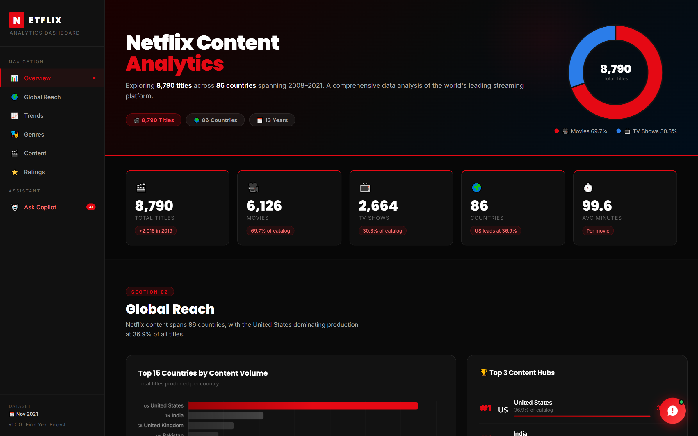
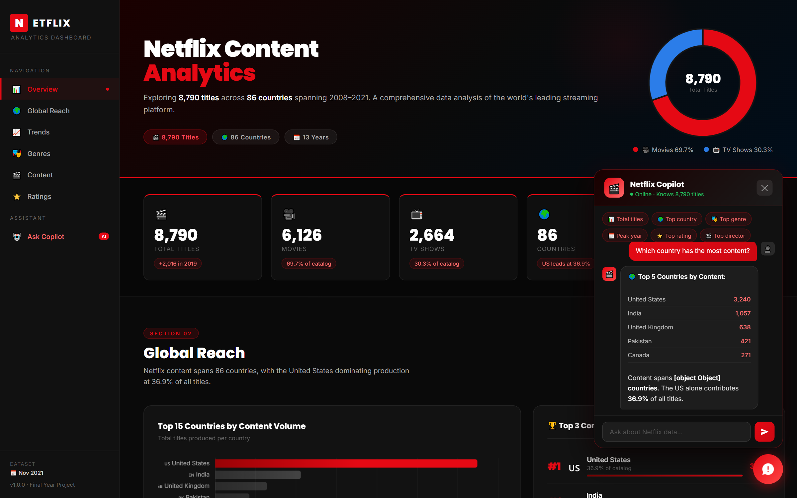
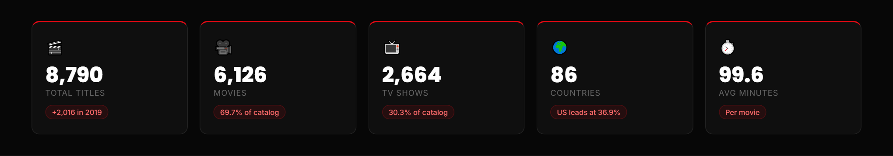
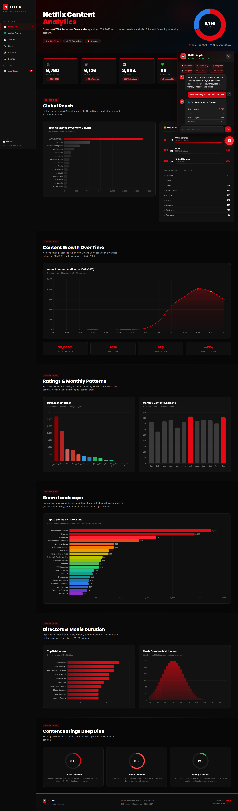
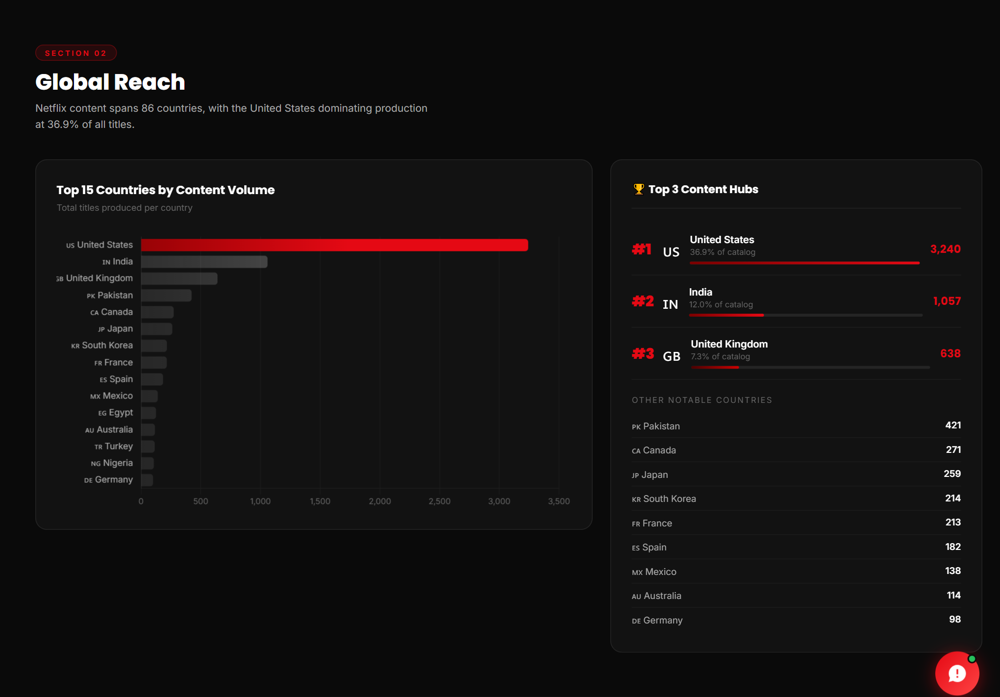
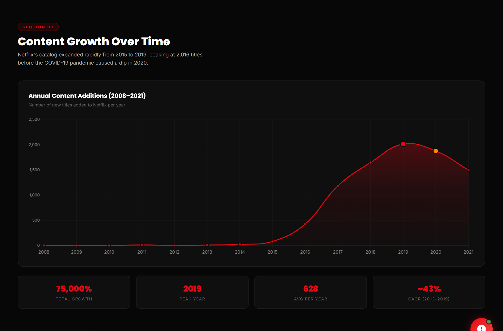
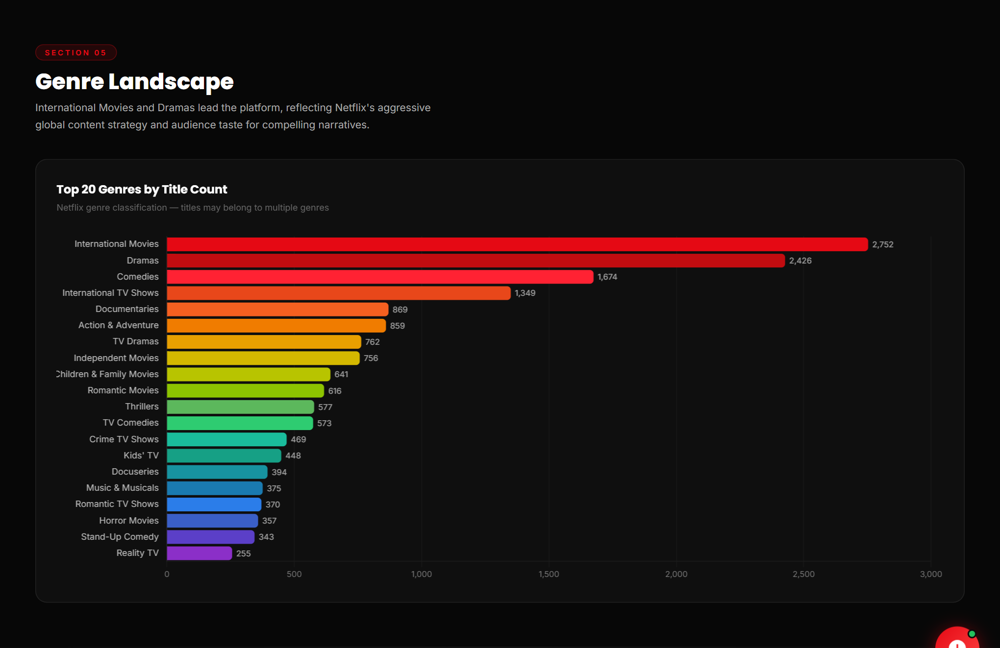
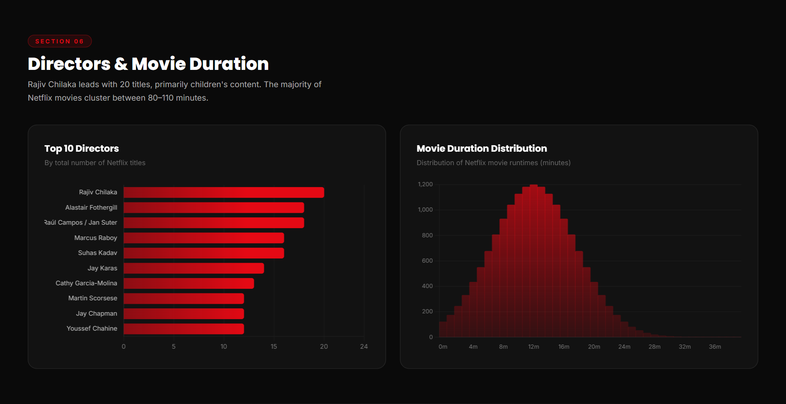

# 📸 Dashboard Screenshots & Visual Gallery

This directory contains high-resolution (Retina / 1.5x DPI) captures of the **Netflix Content Analytics Dashboard** and its interactive AI Copilot.

---

## 🖼️ Captured Views

| Preview | Filename | Description |
|:---:|---|---|
|  | [`dashboard-overview.png`](dashboard-overview.png) | **Main Overview:** Hero banner, donut chart (Movies vs TV Shows), and live status indicator |
|  | [`copilot-preview.png`](copilot-preview.png) | **AI Data Copilot:** Embedded assistant answering questions strictly from the dataset |
|  | [`kpi-cards.png`](kpi-cards.png) | **Executive KPI Cards:** 5 animated metrics (Titles, Movies, TV Shows, Countries, Avg Duration) |
|  | [`full-dashboard.png`](full-dashboard.png) | **Full Dashboard:** Complete view of all 8 sections and visualizations |

---

## 📊 Individual Section Visualizations (`charts/`)

| Visual | Filename | Key Takeaway |
|:---:|---|---|
|  | [`charts/top-countries.png`](charts/top-countries.png) | **Global Reach:** Top 15 producing countries led by US (3,240) and India (1,057) |
|  | [`charts/content-growth.png`](charts/content-growth.png) | **Timeline Trends:** 2008–2021 additions with 2019 peak (2,016 titles) and COVID dip |
|  | [`charts/genres-chart.png`](charts/genres-chart.png) | **Genre Landscape:** 20 dominant categories led by International Movies & Dramas |
|  | [`charts/ratings-directors.png`](charts/ratings-directors.png) | **Audience & Creators:** Prolific directors and movie runtime distributions |

---

## 🔄 Re-generating Screenshots

To capture updated screenshots programmatically after modifying `index.html`:

```bash
python analysis/capture_screenshots.py
```
*(Requires Python with `playwright` installed)*
